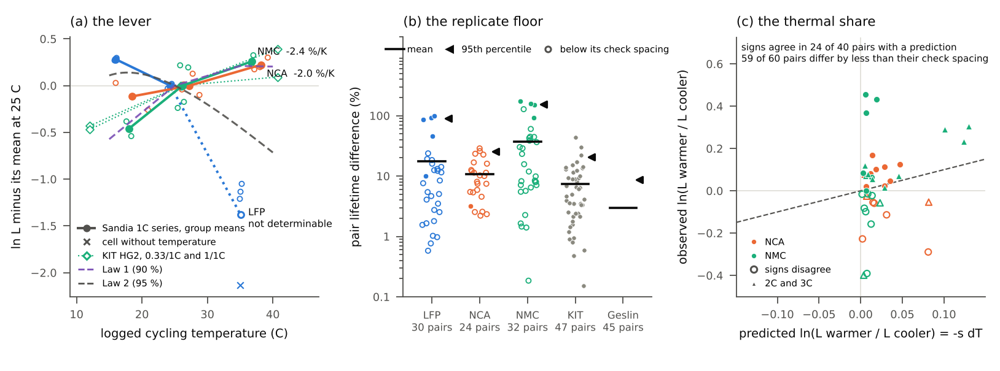
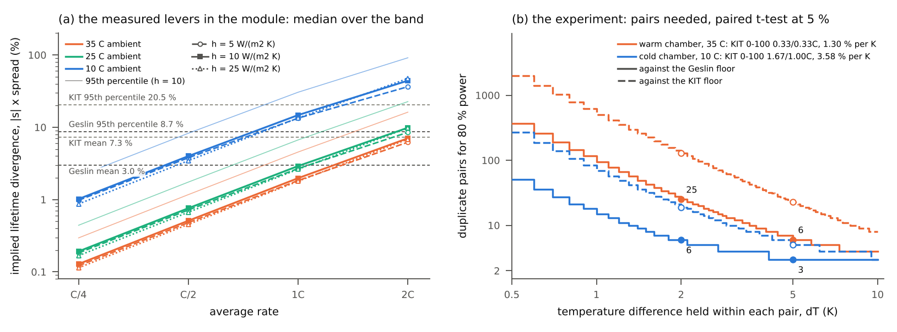

# The thermal lever against the duplicate-cell floor: how large a temperature spread a lifetime divergence needs, and how large a module offers

Siddharth Satte, Independent researcher, Pune, India, 27 October 2026 (first version 10 October 2026). doi.org/10.5281/zenodo.23309130 (all versions). Predictions commit 24ab8d3, public at 08:02 UTC on 10 October before any lever or spread was computed. [github.com/siddharth161204-wq/thermal-lever-duplicate-floor](https://github.com/siddharth161204-wq/thermal-lever-duplicate-floor){.nobr}.

1. For a lifetime difference as large as the duplicate-cell floor's 95th percentile (8.7 %, doi.org/10.5281/zenodo.23205413), two cells at 35 C need a steady 1.68 K under Law 2, an Arrhenius-type LiFePO4 model (0.58 K for the 3.0 % mean). Law 1, the closest published match found to the dataset's cells (NCA+LNO / Si-graphite), peaks near 35 C (102, 126 and 124 cycles to 90 % SoH at 25, 35 and 45 C, C/2 charge): its registered centred slope needs 8.8 K of the opposite sign, yet from 35 to 45 C, where its 0.4C and 0.6C rows slope oppositely, a hotter cell lives slightly shorter: its lever there is weak and of unknown sign.
2. An eight-cell LG M50 module in 35 C air first offers Law 2's 1.68 K at 2C for convection coefficients of 5 to 25 W/(m^2^ K) (4.8 to 5.4 K), with every cell above 55 C, outside both laws' ranges; 1C gives 1.4 to 1.5 K, and no rate up to 2C gives 8.8 K.

Figure 1. (a) |ΔT~floor~| of each law against the floor f; floors dotted, the 95th percentile's bootstrap interval grey. (b) Hottest minus coldest cell of the lumped module (solid) and point of one resolved cell (dashed), with each law's ΔT~floor~ at 3.0 and 8.7 %. (c) The implied divergence |s| × ΔT. Open circles, post hoc: the module at h = 10 with each dataset cell's own cycle-averaged heat.

## Method

1. Floor: the published re-analysis of the 45 duplicate pairs of Geslin et al. (Nature Energy 2025), all at 35 C, at 90 % SOH: pair lifetime difference 2.99 % on average and 8.72 % at the 95th percentile; worst of eight cells 4.10 % below their mean.
2. Laws: Law 1 is the printed cycles to 90 % SoH of Kucinskis et al. (J. Power Sources 2022) at 15 to 55 C and charge rates 0.2C to 0.6C (0.5C discharge), interpolated to a C/2 charge; Law 2 is the full model of Schimpe et al. (J. Electrochem. Soc. 2018, Table IV) at a C/2 charge and each discharge rate; its calendar term, which the paper adds for a cycling cell, carries 57 to 78 % of the loss at 35 C (cycling terms alone: s = 0.051 against 0.052 per K). s = −d ln L/dT at 35 C; ΔT~floor~ = f/s.
3. Proxy cell: LG M50 (21.1 by 70.1 mm), a 21700 but not the dataset's cell, so it sets magnitudes, not values; heat (c&nbsp;×&nbsp;5&nbsp;A)^2^ × 18.71 mOhm, the resistance reproducing the C/2 cycling heat of PyBaMM's Doyle-Fuller-Newman model (ORegan2022) at 35 C.
4. Module: two rows of four at 23.1 mm pitch; between neighbours a 6.2 mW/K nickel strip, 17.4 mW/K across the 2 mm air gap and grey radiation (view factor 0.16); convection and radiation (emissivity 0.8) to 35 C air.
5. Resolved cell: the two-cell study's scikit-fem cell unchanged (roll 1.3 W/mK across and 25 W/mK along the layers, 0.25 mm can), uniform heat, no neighbour, same losses, steady state.
6. Checks: Law 2 gives 8.6 % (8.9 % with its high-SOC term, post hoc) and 10.4 % loss after 2800 cycles at 1C, 25 and 45 C (paper: under 9 % and 12 %); energy closes to 1e-12; the resolved cell's surface mean matches a lumped cell, and its volume mean lies 1.8 to 5.2 % of the rise above, failing the brief's 1 % test as foreseen; a mesh refinement moves the spread 0.8 %. An independent recomputation reproduces the levers and the module to round-off and puts the cell's spread 1.2 % higher.

## Limits

1. Neither law was fitted on the dataset's cells. Law 1 rests on a 10 K table: at each cell's own temperature, all above 35 C, it gives the hotter cell the shorter life, against its registered slope, and at 1C, with the cells at 40 to 50 C, pair differences from 0.2 % (h = 25) to 20 % (h = 5) (exploratory).
2. The proxy cell and a derived resistance without contact resistance set the heat (a 10 s or 30 s pulse value gives 0.32 or 0.43 K at C/2), held steady at its cycle average, which the linear lever allows to first order; the cells follow each phase (time constants 0.2 to 0.5 h, post hoc), so the spread nears 0.35 to 0.39 K in each C/2 charge and about 2 K in the hottest dynamic C/2 discharges.
3. One lumped geometry, one strip per pair, no diagonal coupling; the radiation form matters (the received form gives 0.65 K at C/2). A cold plate under the bases cuts the C/2 module spread to 0.02 to 0.04 K but raises the cell's own to 0.29 K.

## Prediction scorecard

| | Prediction | Result | Computed |
|--|-------------------------------------------------|------|---------------------------------------------|
| P1 | ΔT~floor~(8.7 %) lies between 1 and 3 K for every law | Failed* | Law 2: 1.68 K; Law 1: −8.81 K (central 1.7 and −8.8 K) |
| P2 | At C/2 and h = 10 the module spread is below 1 K | Held | 0.39 K (central 0.39 K); 0.37 and 0.35 K at h = 5 and 25 |
| P3 | At C/2 the resolved cell's spread is below 0.5 K | Held | 0.092 K at every h (central 0.12 K) |
| P4 | The module first exceeds ΔT~floor~(8.7 %) at 1C or higher with h = 10, one rate lower with h = 5 | Failed* | First clause held (Law 2 at 2C, Law 1 not up to 2C); h = 5 gives the same rates |
| P5 | The two laws' ΔT~floor~(8.7 %) differ by less than a factor of 2 | Failed* | A factor of 5.2 to 5.3, of opposite signs (central about 5) |

&#42; A failure that predictions.md expected before any lever was computed.

## What it means for the thesis

At the dataset's rates with constant-current heat a module stays inside the floor under both laws (at most 0.39 K, 2.0 % under Law 2), but with the current variance the dataset publishes for its dynamic discharges and its CC-CV charge, six of its eight dynamic C/2 protocols reach 3.5 to 6.1 % under Law 2 (post hoc, h = 10), above the 3.0 % mean, while Law 1's registered slope keeps every protocol below 1.2 %. Whether a module can show a thermal share above the floor therefore turns on the dataset cell's own cycle life against temperature near 35 C, which the closest published law cannot fix even in sign: that is the first measurement the thesis needs, and the dataset's own divergence, from cells in separate fixtures in a 35 C chamber whose own temperatures are not reported, is neither shown nor ruled out as thermal.

## Stage 2: the lever measured (v1.1.0)

On the KIT ageing dataset of Luh and Blank (doi.org/10.35097/1969; LG INR18650HG2, SiOx-graphite anode; twelve protocols at 0, 10, 25 and 40 C, three cells each, cell temperatures logged; predictions commit f15ee11, pushed before any cell value was read), the lifetime to 90 % changes from 25 to 40 C by −3.45 to +1.91 % per K with the protocol: positive at a 0.33 C charge in five of six protocols (mean 0.95 % per K), negative at 1C and faster; from 10 to 25 C it is negative in all twelve. Stage 1's 0.391 K module offer therefore moves lifetimes by at most 1.35 %. The dataset's own replicate floor is 7.3 % (mean) and 20.5 % (95th percentile), larger than the Geslin floor, and the warmer replicate reached 90 % first in only 40 % of 142 pairs, so the spread among replicates is not ordered by their logged temperatures. Five of eight predictions held (P1, P4 and P5 failed); a separate recomputation agrees to 5e-13. Figure and scorecard: results/stage2_figure.png and the README.

## Stage 3: the lever in a second laboratory's data (v1.2.0)

On the Sandia cycling study of Preger et al. 2020 (doi.org/10.1149/1945-7111/abae37, via batteryarchive.org; 86 LFP, NCA and NMC 18650 cells at 15, 25 and 35 C; predictions commit bf4b993 and a correction for records logged out of cycle order, D50, both pushed before any result), the 1C lifetime to 90 % rises from 25 to 35 C: s = −2.4 % per K for NMC (the KIT cell, inside its KIT band) and −2.0 % per K for NCA; from 15 to 25 C s is −5.6 (NMC), −1.3 (NCA) and +3.4 % per K (LFP, to 95 %). LFP's 25 to 35 C lever is not determinable as registered: one 35 C cell logged no temperature before its lifetime (+13 % per K post hoc). With checks 60 to 470 cycles apart, 59 of 60 replicate pairs are tied, so neither the floor (mean 11 to 37 %) nor the sign test resolves the cells. Stage 1's 0.391 K offer moves NCA lifetimes by 0.8 %. Four of ten predictions held (four failed, two not scored); a separate recomputation agrees to 7e-13.

{style="width:100%;margin:2pt 0 0 0"}

Figure 2. Stage 3. (a) ln L against the logged cycling temperature on the 1C series, with Law 1 (90 %), Law 2 (95 %) and the KIT NMC protocols at a 1C discharge. (b) The replicate floor per chemistry beside the KIT and Geslin floors. (c) Observed against predicted ln lifetime ratio per pair; filled where the signs agree.

## Stage 4: the measured levers in the module, and the experiment that would settle it (v1.3.0)

Stage 1's module at 35, 25 and 10 C ambient, heated through the same PyBaMM procedure (18.7, 26.6 and 47.9 mOhm; predictions commit c1e58a1, pushed before any run), offers 1.4 to 1.5 K at 1C and 4.8 to 5.4 K at 2C at 35 C, and 3.7 to 4.1 K at 1C at 10 C. Under each band's median measured lever (1.30 % per K from 25 to 40 C, KIT and Sandia; 3.58 % per K from 10 to 25 C), a 35 C module passes the Geslin mean floor only at 2C (6.2 to 7.0 %) and its 95th percentile at no rate; a 10 C module offers a share from C/2 and a detectable one from 1C (13 to 15 %), though from 1C and 2C with the 25 C resistance, nearer the cells' own temperature. The levers come from chamber set points: applying them inside a module assumes them local and linear over a few kelvin. To settle it, a paired t-test of log lifetimes with the Geslin floor as log-normal noise needs 3 duplicate pairs held 5 K apart at 10 C and 25 pairs held 2 K apart at 35 C (KIT floor: 5 and 128), up to 29 % fewer with a normal floor. Four of seven predictions held (P2, P5 and P7 failed); a separate recomputation agrees to XXX.

{style="width:100%;margin:2pt 0 0 0"}

Figure 3. Stage 4. (a) Median implied divergence |s| × spread over each band's levers against rate, at three ambients and three coolings, with the band's 95th percentile at h = 10 and the four floors. (b) Duplicate pairs for 80 % power against the temperature difference held within each pair, under each chamber's median lever, against the Geslin (solid) and KIT (dashed) floors.
